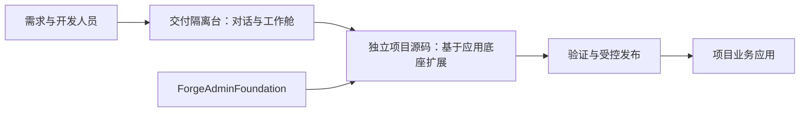

# Forge Admin Harness · 交付隔离台

2026-10-28 已同步维护主干的最新可公开源码；变更、验证与未覆盖项见[版本状态](docs/release-status.md)。

**面向团队的 AI 开发与交付平台：将对话、独立工作空间、开发规范、验证和受控发布组织到同一条工作流程。**

由 [zhiyuxinxi](https://github.com/zhiyuxinxi) 维护，基于 DeepSeek Harness 的运行基础扩展，并与 Forge Admin 应用生态配合使用。用户在自己的项目和对话中开展需求分析、代码开发与修复；平台提供任务隔离、资料读取、规范化工具和交付状态管理。

[功能详解](docs/features.md) · [AI 能力总览](docs/ai-capabilities.md) · [从这里开始](docs/getting-started.md) · [文档索引](docs/README.md) · [版本与已知限制](docs/release-status.md) · [配套应用底座](https://github.com/zhiyuxinxi/ForgeAdminFoundation)

> 当前提供经清理的公开源码快照。维护仓库持续开发，公开版按阶段同步，可能落后于维护主干。公开安装仍有镜像和环境准备条件，尚无本公开快照在干净环境完整安装通过的结论；开始前请阅读[上手条件](docs/getting-started.md)和[具体限制](docs/release-status.md)。

## 适合哪些团队

- 希望通过 AI 辅助开发企业业务系统，又需要组织项目权限、代码协作与发布流程的团队。
- 已采用 Forge Admin 或其修改版，需要复用底座、统一生成规范并减少重复环境准备的开发团队。
- 需要把不同人员、项目及对话的工作空间分开，并追踪验证和发布结果的交付负责人。
- 具备 Linux、容器和应用运维能力，愿意按自身环境部署、配置和验证的平台维护者。

如果你只想开发一个后台业务应用，可以先独立使用 [ForgeAdminFoundation](https://github.com/zhiyuxinxi/ForgeAdminFoundation)。部署交付隔离台还需要模型服务、Git、数据库及平台运行配置，不是使用底座的前置条件。

## 两个项目如何配合

| 项目 | 主要职责 | 用户在其中做什么 |
| --- | --- | --- |
| **交付隔离台**（本仓库） | 组织 AI 开发、隔离工作空间、管理验证与交付 | 选择项目、创建对话、提供需求与资料、审阅结果、保存与申请发布 |
| **ForgeAdminFoundation** | 提供业务应用基础能力 | 开发 PC/H5 页面、Java 接口、表单、流程、权限和业务模块 |



两仓分别维护和发布。图中是职责关系，不代表当前快照已验证两仓一键联装；项目采用的底座版本、源码仓库和运行环境需要明确配置。

## 平台提供什么

| 能力 | 对使用者的价值 | 主要内容 |
| --- | --- | --- |
| AI 对话研发工作台 | 从项目入口组织工作，减少会话与文件归属混乱 | 登录、项目选择、独立对话、恢复工作、交付资料入口 |
| 需求与资料解析 | 在已有材料基础上开展分析，减少反复手工转述 | 文件上传、文档提取、项目资料读取、原型目录索引 |
| AI 辅助开发 | 让需求、数据、页面、接口和权限能够逐步对应 | 分阶段交付工具、工作包、源码操作与定向修复 |
| 开发技能与规范 | 复用同一套开发方法和底座约定 | 前后端、数据库、权限、流程、字典、测试及发布 Skills |
| 多项目与工作空间管理 | 同一团队可开展独立工作，保留各自未提交内容 | 项目准入、人员和对话归属、TaskSpace、Git 候选与集成 |
| 自动化构建与验证 | 用可检查的执行结果辅助判断完成度 | 受控验证入口、Host Runner、依赖准备与回执 |
| 版本管理与受控发布 | 把“代码已保存”“验证通过”和“已发布”分清 | checkpoint、候选检查、Broker、Release Runner 与发布状态 |
| 安全隔离与追溯 | 将 AI 的操作限制在获授权的项目和能力范围 | 身份校验、文件与工具边界、发布白名单、关联记录 |

详见[完整功能说明与源码导航](docs/features.md)。应用底座中的用户、组织、表单和工作流等能力，见[底座功能介绍](https://github.com/zhiyuxinxi/ForgeAdminFoundation)。软件能力、现场实施及培训服务分别说明；不以内部建设条目数量承诺独立可用功能数量或效率倍数。

[AI 能力总览](docs/ai-capabilities.md)用表格列出技能、执行工具、Prompt 与运行支撑组件的中英文名称、用途、场景、产出和边界。当前公开源码包含 **24 个 Skills（4 个 stable、20 个 pilot）**，包含浏览器、Bruno API 调试和 ast-grep 结构化搜索技能。源码、依赖安装和运行启用分别核对。

## 从第一次阅读到第一次使用

### 先了解，不启动服务

```bash
git clone https://github.com/zhiyuxinxi/ForgeAdminHarness-open-source.git
cd ForgeAdminHarness-open-source
```

先看[架构](docs/architecture.md)理解组件关系，再看[安全边界](docs/security.md)。单纯阅读源码无需模型凭据或数据库。

### 准备安装

安装主要面向 Linux、Docker Compose、Git、SSH 与 Bash；Node.js 运行组件要求 **24 或更高版本**。数据库、缓存、构建工具及模型接入按所选项目配置准备。

[上手指南](docs/getting-started.md)说明镜像准备、平台配置、项目 Git 与数据库前提、初始化顺序和未验证环节。不要直接将内部风格的镜像标签当成可下载的公共镜像，也不要在已有生产库试验初始化。

### 平台准备好后开始工作

1. 使用平台管理员分配的个人账号登录，进入被授权的项目。
2. 为一项独立工作新建对话，提供目标、边界和必要材料。
3. 在同一对话中继续开发和修复，审阅模型给出的变更与执行结果。
4. 按项目流程保存代码候选，并区分验证结果与发布结果。
5. 发布请求通过项目配置的受控链路执行；最终查看对应作业的实际终态。

具体操作和异常处理见[运行与日常使用](docs/operations.md)、[故障排查](docs/troubleshooting.md)。

## 源码与文档

| 位置 | 内容 |
| --- | --- |
| [docker/harness](docker/harness/) | Harness 扩展、Gateway、Manager、Broker、验证与发布组件 |
| [docker/harness/skills](docker/harness/skills/) | 随运行版本交付的开发规范与工具使用指导 |
| [templates](templates/) | 项目和工作舱模板 |
| [scripts](scripts/) | 初始化、管理、备份、升级及验证入口 |
| [config](config/) | 版本配置与平台示例 |
| [tests](tests/) | 平台测试与夹具；存在测试不表示本次已运行 |
| [docs](docs/README.md) | 对外阅读、使用与维护说明 |
| [交付作业手册](docs/ai-delivery-playbook/README.md) | 按需求、设计、实现、验证等主题组织的方法资料 |
| [playbook-portal](playbook-portal/) | 作业手册门户源码，需另行构建与配置 |

## 版本、反馈与协作

维护仓库中的新增能力和修复，在同步前不视为本公开版本已包含。公开版本的日期、变化、已知限制和未验证范围见[版本说明](docs/release-status.md)；这里没有承诺固定同步周期。

问题和建议请提交到 [Issues](https://github.com/zhiyuxinxi/ForgeAdminHarness-open-source/issues)，附公开提交版本、环境、复现步骤、预期与实际结果及已脱敏日志。公开源码不包含模型调用额度、服务器资源或商业实施服务。

请勿上传真实密钥、Cookie、私钥、客户数据或完整运行备份。安全问题按[安全说明](docs/security.md)选择可用的私密反馈方式。贡献应注明修改目的、影响范围和实际做过的验证，未执行项如实列出。

## 上游与许可证

本项目采用 [Apache License 2.0](LICENSE)，第三方组件遵循各自许可证，详见 [NOTICE](NOTICE)。

- [DeepSeek Harness](https://github.com/deepseek-ai/deepseek-harness)：提供运行基础，适用其 MIT 许可证；本仓库增加项目和对话隔离、管理与交付链路等集成能力。
- [Forge Admin](https://github.com/yaomindong1996/forge-admin)：应用生态的上游基础；本维护者加工的公开底座为 [ForgeAdminFoundation](https://github.com/zhiyuxinxi/ForgeAdminFoundation)。
- Mermaid、可选文件服务及其它依赖保留各自归属与许可。

本项目是独立维护的集成与扩展版本，不代表上述上游的官方发行或背书。

## 项目结构

通用源码位于 `docker/`、`scripts/`、`templates/`、`config/`，测试位于 `tests/`，门户位于 `playbook-portal/`。文档采用 A0–A4 分层，历史一次性补丁移到 `docs/90-a4/raw-artifacts/`；阅读入口为[项目阅读入口](docs/00-a0/00-read-first.md)。2026-10-18更新内容及验证边界见[版本记录](docs/release-status.md)。
