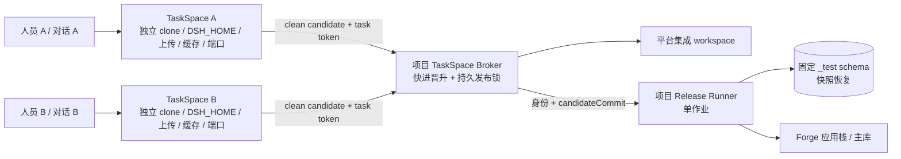
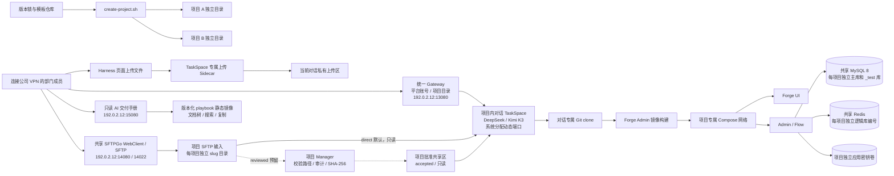

# 平台架构

核对日期：2026-09-21。运行版本、候选与完成边界统一见[当前状态](当前状态.md)；本页描述组件职责与现行约束，不把旧部署样本当实时盘点。

### Host依赖预装与直接复用（2026-09-21）

2026-09-22候选补修：Host校验缓存从单进程Map扩展到既有私有stateRoot下的摘要记录；跨启动先检查完整文件元数据与manifest，只有与之前完整内容校验一致才跳过读取全部文件字节。缓存损坏/缺失仍走原校验，元数据变化须重新验证内容。候选46398fca及Host.22.2已通过镜像专项，尚未部署；不改变业务执行/验收合同或公共依赖只读挂载边界。

预装基础来自服务器既有缓存，按固定依赖输入与实际工具补齐并验证后进入版本化镜像和服务器受保护目录。当前已发布31ac直接复用、32b/Host.21.3的Maven来源兼容；新Harness中DeepSeek和GPT均已实际通过后端验证，依赖零下载、安装、整树复制。前端执行位与只读安装树的平台消费者已通过，原三舱实际续验仍须分别取证。具体见[阶段验收](validation-evidence/2026-09-21-依赖直接复用阶段验收.md)及[全局TODO](../00-全局总待办-TODO.md)。

正常Host验证优先直接只读使用兼容的服务器预装目录，保留各舱已有缓存，不每舱复制或装配相同依赖。manifest绑定项目、依赖输入、工具和内容；不兼容时沿既有隔离准备路径处理，不假报命中，也不跨舱共享可写依赖。工具临时写入和业务输出单独隔离。预装成功不等于编译、测试或业务验收通过；Harness仍经Broker请求Host执行固定profile。

前端已有安装树通过同文件系统rename一次发布为受保护只读制品，`preparedDependencies.root/manifestSha256`绑定；Host首次校验版本后复用，跳过安装与整树复制，Vite临时目录独立挂载。Maven只读挂载兼容seed仓库并离线执行，在派生settings中保留原central来源映射和checksum要求，不改写种子。可执行位在导出、冻结和恢复中保留，普通文件不增加执行位。镜像同时保留预装基础用于版本化交付，但Host命中服务器准备目录时不再从镜像复制整树。原复制640.848679秒、执行位丢失及来源不兼容的失败原件见[三舱复盘](validation-evidence/2026-09-21-三工作舱阻塞修复与复盘.md)。

### 普通对话发布的候选准备顺序（2026-09-19，部署状态见验证记录）

Broker在当前源码验收后只获取候选Git对象，由Runner在项目私有ops目录隔离检出精确提交，执行既有构建、迁移和启动检查；失败时共享分支及私有远端不推进。准备成功后Broker重新核源码和受保护验收，再按原Git边界晋升；Runner发布同一已验证镜像ID并执行最终健康检查。任务工作舱的草稿checkpoint仍允许保存未完成修复。旧的“先晋升再构建”描述保留为历史，当前实现与证据见[合入前候选检查](validation-evidence/2026-09-19-合入前候选启动检查修复.md)。

受保护部署输入的候选审批补充已由 B 分支6f7b04ab交付隔离Runner（v120/image07c2），审批02实际消费通过，业务迁移与恢复尚待验证：平台 runtime contract 可选的 `release.protectedCandidateApproval` 绑定候选提交、原受保护路径、原摘要和获批摘要。只有该提交的干净工作区使用这一文件的新摘要；旧 canonical 仍按原摘要校验，候选准备成功并正常晋升后使用同一审批。它不改变先准备后晋升的顺序，也不把模型请求中的 `approvalRef` 当作平台审批。晋升后通过既有合同生成入口刷新 canonical 主摘要，会移除这份临时候选审批；实施期间不得提前重生成旧 canonical 合同而丢弃当前审批。


> 基础Harness、外置Skills与宿主Host Runner是独立升级单元；Broker、发布Runner和Gateway也有各自实际消费者。当前工作见[任务交接](../TASK_HANDOFF.md)，旧工具包交接仅为历史来源。升级某一单元不意味着旧舱或其他服务全部升级。

## 统一入口与项目控制面

同一服务器只保留一个固定 Harness 平台入口（默认 `192.0.2.12:13080`）。登录后先看到 `projects.tsv` 中全部 Forge Admin 交付项目的数量、名称、类型、Forge UI 地址和可进入状态，再选择项目查看自己的对话。不同 Forge Admin 副本就是不同交付项目；它们继续拥有独立代码、Compose、网络、卷、Forge UI 端口、主/测试数据库、Redis 分配、密钥和发布队列，不再拥有互相分裂的 Gateway 账号库。项目登记表中的历史 `harness_port` 字段仅为兼容字段，统一写入平台入口端口，不表示项目有独立登录端口。

每个交付项目同时绑定一个独立私有 Git 远端。服务器项目集成工作区仍是 TaskSpace 的只读基线，但不再是唯一历史副本：Broker在项目发布锁内核对集成与远端身份；当前链路先在隔离候选中完成必要构建/迁移/启动检查，再重新核对源码、授权和验收，按原快进边界晋升并发布同一已验证镜像。只有 Broker 直接挂载项目独立 Deploy Key 并拥有受限 Git 出站网络；Harness、TaskSpace 和 Gateway 没有密钥或 Docker 权限。Manager/Runner 不直接挂载密钥，但因其固定控制面职责拥有 Docker 权限，仍属于可间接影响宿主挂载的特权信任边界，必须用版本化代码、固定 API、审计和主机权限共同保护。

人员权威是平台唯一 `user.id`，项目准入权威是显式 `userId + projectSlug` membership，对话权威是 `projectSlug + conversation UUID + ownerUserId`。平台管理员默认能进入全部项目并管理账号/成员关系；普通成员只能进入明确授权的项目；不存在任意接管别人对话的`open-any`权限；管理员只读查阅他人归档文件属于独立受限入口，不等于可打开、写入或接管其对话。用户选择项目并新建对话后，系统把该对话映射到该项目的 `accessMode=conversation` TaskSpace。每个 TaskSpace 继续使用独立 clone、任务分支、`DSH_HOME`、上传、缓存、命名卷和主机动态端口。

数据流为：浏览器登录统一 Gateway → 选择项目 → 创建对话 → Gateway 通过该项目专属 Unix capability socket 调用 `conversation-manager` → Manager 以固定参数执行 `taskspacectl create` → 浏览器打开分配端口 → TaskSpace 代理通过平台只读鉴权 Unix socket 对每个 HTTP/WS 请求重新校验账号、项目成员关系、对话所有者、状态、Host 与 Origin → 授权后剥离 Gateway cookie 并转发到容器 loopback 的 DSH。

统一 Gateway 只挂载平台账号/审计状态、只读项目登记表和每项目窄 Manager capability 根；它没有 Docker socket、任何项目 workspace、数据库/模型 Secret，也不加入项目应用网络。每项目 `conversation-manager` 仍是唯一能启动/停止本项目 TaskSpace、列出待审资料和执行资料批准的高权限进程：无主机端口、`network_mode: none`，仅暴露项目独立 Unix socket。Manager 只接收 `project.env` 中非秘密的控制变量，健康检查必须执行 `taskspacectl preflight`；不得通过放宽宿主 `platform.env` 权限来让非 root Manager 读取平台配置。TaskSpace 不再共享跨项目 Docker 鉴权网络，只读挂载单一鉴权 socket 目录，因此项目和对话之间没有额外横向网络通道。

平台状态位于 `/srv/forge-delivery/conversation-control-plane/state/{state.json,audit.jsonl}`，权限为目录 0700、文件 0600。Operator token/socket 与浏览器鉴权 socket 使用不同目录；每项目 Manager token/socket 位于 `/srv/forge-delivery/conversation-control-plane/projects/<slug>/`，不写仓库、不暴露给 Harness。旧项目本地状态在维护窗口冻结全部旧 Gateway 后一次性合并；`forge-base` 同名账号记录为凭据权威，其他项目唯一账号并入，非主项目管理员默认降为 member，旧浏览器 session 全部撤销。

项目内所有 TaskSpace 端口同时登记到主机 `registry/taskspace-ports.tsv`，并由 `taskspaces.lock` 串行分配。登记在停止、关闭或创建失败后仍保留，因为相应工作舱和证据未被销毁。项目级生产发布仍由 Broker/Runner 锁串行处理；对话并行只解决工作区与过程状态隔离，不放宽数据库或生产发布互斥。

每个TaskSpace保留独立依赖缓存，不跨用户、对话或项目共享可写目录。历史`/workspace/.forge-cache`挂载不意味着模型可直接执行Maven、npm或pnpm；当前业务验证使用Broker→Host固定profile，工具路径、Maven设置与缓存由实际Host合同约束。缓存不进入候选Git提交；昂贵缓存失败后优先复用，不以‘可重建’为理由直接删除。

资料流分两条：当前对话网页上传 → 当前 TaskSpace 私有 `/project-inputs`；SFTPGo/WebClient 递归上传完整项目目录 → 当前项目文件根 → 同项目 TaskSpace 只读 `/project-ftp-inputs`。默认 `PROJECT_MATERIAL_ACCESS_MODE=direct`，不需要管理员批准；管理员审核复制到 `/project-shared-inputs` 的 `reviewed` 模式继续保留，但不是当前默认工作流。两条输入都属于不可信低权威资料，不能执行其中的脚本、宏或 AI 指令，也不会自动成为项目文档或 Memory。详细权衡见 ADR-0008 与 `docs/decisions/0009-direct-sftp-project-folder-inputs.md`；ADR-0006 的逐请求对话归属与 TaskSpace 隔离仍有效。

### 应用运行模式：PC三服务与移动四服务

新项目可按实际基础源码使用`pc-only`三服务模式（Admin/Flow/UI）；不能强求缺失的App Dockerfile。需要移动端且源码/合同支持时，继续使用业务仓库已有的 `forge-h5-ui` 和 `forge-app-server`，不另起 Flutter、React Native 或独立后端。项目应用栈扩展为 `forge-admin + forge-app + forge-flow + forge-ui`：`forge-ui` 同时携带 PC 和 H5 静态产物，移动请求经同源 `/forge-h5-api/` 反向代理到只 `expose 8583` 的 `forge-app`；宿主机不新增 App API 端口。这样复用现有 RBAC、租户、字典、表单、流程、消息和审计语义，并让一次业务提交、一次测试库迁移、一次 Broker/Runner 发布同时约束 PC 与移动端。

功能匹配按业务结果、权限、数据和状态机对等定义，而不是把 PC 页面缩小。第一阶段交付 H5 响应式入口；PWA 必须在受信 HTTPS、manifest、service worker、缓存/失效和安装测试完成后单独启用；原生 App 只在相机、扫码、通知、定位、蓝牙、离线或企业分发有明确需求时启用 uni-app 原生构建。App ID、签名、商店/企业分发账号、系统权限说明和真机矩阵属于外部身份与设备验收，不能由桌面浏览器替代。

现有项目升级分两段，避免把平台契约和业务发布混成一次不可回退变更：先用 `upgrade-mobile-runtime.sh` 只升级 Runner/Broker 和四服务契约，记录唯一 clean TaskSpace 候选且验证原 Admin/Flow/UI 容器 ID 不变；再由该TaskSpace请求Broker/Runner完成候选准备检查，通过后快进私有Git并发布绑定镜像，执行H5/App冒烟。详细决定见 [ADR-0011](decisions/0011-four-service-mobile-runtime.md)。

## 项目共享，任务不共享

每个对话使用独立工作舱，不共用可写工作区。项目仍共享 Forge Admin 应用栈、集成 Git 历史、主库、`_test` 库、Redis 分配、Release Runner 和审计；每个人的每个对话任务则运行在独立 TaskSpace 中，不共享任何可变开发状态。



TaskSpace Harness 只写自己的 `/workspace`，只读看到 `/integration`、项目 SFTP 目录 `/project-ftp-inputs`、预留审核共享区 `/project-shared-inputs`；网页直接上传进入自己的 `/project-inputs`。它没有 Docker/Runner Socket、数据库凭据、项目 `ops`、其他 TaskSpace 或宿主机上级目录。`forge-release` 自动通过 Broker；Broker 是唯一能写集成 workspace 的进程，但没有 Docker Socket或数据库凭据；Runner 是唯一能执行部署的进程，并再次核对不可变候选 Commit。

项目目录扩展为：

```text
/srv/forge-delivery/projects/<slug>/
  workspace/                    平台管理的集成 Git 工作区
  ops/                          项目 Compose、契约、Runner 状态和 release socket
  backups/                      测试库恢复快照
  dsh-home/                     已退役共享 Harness 的保留状态（不默认启动）
  shared-inputs/
    accepted/                   管理员批准后、同项目 TaskSpace 只读共享
    governance/                 资料批准事件和 SHA-256 审计
  taskspaces/
    .broker/                    发布锁、状态和审计
    <task-id>/
      metadata.json             Task/Actor/Conversation/Base/Port/Token 哈希
      task.env                  0600 的工作舱运行参数
      workspace/                独立 Git clone
      dsh-home/                 独立会话与设置
      uploads/                  独立网页上传区
      tokens/                   0600 的 Broker/浏览器令牌
```

同一文件并行修改不会互相覆盖；同模块后发任务必须包含最新集成提交，冲突在自己的 clone 中解决。A 工作时 B 发布不会改变 A 的文件或会话，但会推进集成 HEAD，因此 A 后续发布必须重新集成。数据库不为 AI 暴露任意操作槽；所有迁移经一个 Runner 串行执行，失败只污染固定测试沙箱并由下一次修正版发布先恢复已验证快照。

vpn37 把发布失败收敛补全为两条状态机。测试迁移容器带精确 project/role 标签；Runner 中断后持久状态保持 `migration-pending`，下一次发布只清理同项目、同角色的遗留容器，验证快照后恢复测试 schema，再重新迁移。应用部署后必须同时通过 UI/API 冒烟；失败时恢复旧 env 与旧 image ID、重新部署并再次验证 UI/API，只有旧版本健康才报告 `application-rollback-verified`，否则升级为独立的 `APPLICATION_ROLLBACK_FAILED`，不得把“执行过回滚命令”当成恢复成功。

项目复制和灾难恢复都绑定登记身份。复制从已登记来源的显式 clean commit 执行无 hardlink clone，目标拥有独立数据库、Redis 编号、Compose 资源、密钥卷和 TaskSpace；平台账号与客户资料不随副本复制，新项目 SFTP 目录和 `shared-inputs/accepted` 默认空。项目恢复包在维护窗口冻结任务与核心服务，同时捕获 bind-state、项目 SFTP 输入、批准共享区及治理审计、主/测试 schema、两个 Redis 逻辑库和 crypto 卷；SHA-256、registry row、项目 slug、数据库/卷身份、Compose 服务集合及 TaskSpace 元数据必须一致。恢复失败时用 pre-restore safety copy 回滚目标，安全副本不自动删除。运行时 Unix socket 和可重建索引/依赖缓存不进入恢复包，由服务或 TaskSpace 重建。项目 Git 私钥也不进入业务数据恢复包：同机原位恢复保留受限的 `/srv/forge-delivery/git-remotes/<slug>`；跨机恢复必须重新生成 Deploy Key、在 GitLab 复核授权并重新执行 `attach`。

## 产品目标与阶段

目标是在武汉机房 VPN 内建立一个可重复创建的 AI 辅助交付环境，使交付人员基于同一 Forge Admin 技术底座完成不同客户项目，同时把跨项目污染、版本漂移、误操作和不可追溯风险控制在可接受范围内。应用与 Harness 运行在 `192.0.2.12`，数据库和缓存复用北京机房现有共享服务。

平台已有项目创建、独立对话、受控验证与发布等分场景交付证据，仍有明确平台缺陷、业务欠项及完整验收欠账。完成范围以各回执和[全局TODO](../00-全局总待办-TODO.md)为准，不再用早期‘0→1已完成’概括所有能力。无人值守生产发布、跨机自动容灾、企业IdP与计费等不因文档更新而纳入实施。

## 事实、假设和待验证项

已确认的稳定事实：

- 上游身份固定在[versions.env](../config/versions.env)，Forge与Harness不能只凭可变tag升级；
- 统一Gateway、项目membership和逐请求归属检查补充DSH入口身份；
- 应用/控制面与共享MySQL、Redis分开管理，项目使用独立主库/测试库和资源分配；旧项目账号/远端例外仍需单独核对；
- 服务器容量、Docker/Compose版本、在线舱数属于随时间变化的观察，读取[最近资源记录](validation-evidence/2026-09-20-服务器与Docker资源分析.md)并在实际操作前核现场，不能把早期32GiB/空闲磁盘数当当前事实。

假设：

- 一期项目数和并发交付人数有限，允许共享 MySQL/Redis 实例并用数据库名、账号授权和 Redis 逻辑库做项目隔离；
- 交付人员连接公司 VPN 后直接访问项目 UI/Harness；服务器运维仍使用个人 SSH 账号；
- 每个客户项目创建时都必须有独立本地 Git 工作库和独立私有 Git 远端；`forge-base` 已在 vpn50 验收中绑定 `maintainer/sampleco`，本地与远端集成 HEAD 已核对一致；`forge-replica-acceptance` 及后续项目仍须逐项目建立自己的私有仓库和 Deploy Key，不得复用 `sampleco` 或把服务器本地提交冒充异机副本；
- DeepSeek、Kimi、智谱 GLM 等模型凭据由项目负责人配置为服务器 Secret，不写入平台仓库或项目工作区。新增供应商仍须完成数据出境、账号权限与模型可用性审查。

待验证：

- 同时运行项目数、峰值 Maven/前端构建并发和可接受资源配额；
- Forge Admin 的客户定制、数据库迁移、测试覆盖和交付验收标准；
- 客户数据分级、源代码出网限制、模型供应商合规和日志留存期限；
- 多人独立 TaskSpace 并行开发时的真实冲突率、同项目发布重试频率和会话审计满足度。

## 逻辑拓扑



## 隔离单元

每个项目目录固定为：

```text
/srv/forge-delivery/projects/<slug>/
  workspace/    平台管理的 Forge Admin 集成代码库与项目 Git 历史
  ops/          compose.yaml 和权限为 0600 的 project.env
  dsh-home/     Harness 设置、凭据引用、会话和项目级插件状态
  backups/      预留的项目本地备份工作区
  shared-inputs/
    accepted/   管理员批准后同项目共享的只读资料
    governance/ 资料批准事件与哈希审计
  taskspaces/    每任务独立 clone、会话、上传、令牌与 Broker 审计
```

项目代码/运行空间保持上述结构不变。产品和业务上传属于独立的数据入口，不直接
放入代码工作区：

```text
/srv/forge-delivery/file-gateway/
  file-gateway.env       0600，固定镜像、端口和初始管理员凭据
  state/                 SFTPGo SQLite、主机密钥和服务状态
  backups/               SFTPGo 配置导出的本地暂存区
  data/
    <slug>/              对应一个已登记交付项目的原始上传目录
```

一台服务器只运行一个平台级 SFTPGo 实例。它与共享 MySQL/Redis 类似，属于平台
入口能力，不属于客户应用栈；每个项目仍保持独立部署、目录和恢复边界。SFTPGo
容器只挂载 `file-gateway` 自己的三个子目录，不挂载 `projects/`、平台仓库、
Docker socket 或秘密目录。这样无需重构现有项目 Compose，也把共享入口被攻破时
的影响限制在原始上传资料平面。

AI 交付手册与文件入口一样属于平台级服务，但采用独立 Compose 项目：

```text
/srv/forge-delivery/playbook-portal/
  playbook.env       0600，只记录绑定地址、端口、源码哈希和不可变本地镜像 ID
```

门户构建阶段只读取 `docs/ai-delivery-playbook/`、自身前端源码和设计/交互合同，
将文档内容编译进版本化静态镜像；运行阶段不挂载宿主机目录、项目数据卷、Harness
状态、Docker socket 或任何 Secret。服务只提供读取、搜索、复制、下载、分享定位
和打印，不提供在线修改权威 Markdown 的 API。文档更新必须先在仓库评审和校验，
再构建新镜像、记录源码哈希并定向替换门户容器。

初始 `forge-all-projects-upload` 组在根目录只有 `list`，在每个登记项目路径只有
`list/upload/create_dirs`。因此普通用户能选择项目并上传，但不能下载、删除、
覆盖或重命名。后续需要保密隔离时，在 SFTPGo 中按项目建立组和虚拟目录，不改变
宿主机目录模型。

每个 TaskSpace Harness 只读挂载自己的私有上传目录到 `/project-inputs`、当前项目 SFTP 根到 `/project-ftp-inputs`，并保留项目 `shared-inputs/accepted` 到 `/project-shared-inputs`。它不会看到其他 TaskSpace 的私有上传，也不会看到其他项目的 SFTP 根。三个入口的文件都属于低权威输入，不自动成为项目事实、项目文档或 MCP Memory；默认链路为 `SFTP/private upload -> 只读分析 -> 代码或文档草案 -> 验证 -> 人工确认`。需要合规审批时切换 `reviewed` 模式，沿 `intake -> accepted -> 审核后的项目文档 -> candidate Memory` 处理。

部门成员的首选入口是自己的 TaskSpace Harness 输入框旁的“上传文件”按钮或输入区拖放。浏览器
通过 Harness 同源 `/forge-upload` 接口逐文件上传，成功后只把该批次的
`/project-inputs/incoming/<date>/<batch>/<filename>` 路径回填到当前输入框，不自动
发送消息。用户确认并发送后，模型才能沿只读路径读取资料。SFTPGo 是完整目录、批量资源和
Axure/静态前端项目的首选入口；Harness 页面上传适合当前对话的少量单文件，两者职责不同。

每个活跃 TaskSpace 额外运行一个 `harness-upload` Sidecar。它只连接该工作舱内部的 `uploads`
网络，只读容器根文件系统，并且唯一的可写挂载是当前 TaskSpace 的 `uploads/`；它不
挂载工作区、`dsh-home`、模型 Key、平台目录或 Docker socket。Harness 入口代理验证
精确 Host、同源 Origin 和 Fetch Metadata 后，以工作舱内部令牌转发原始文件流；
浏览器不会获得该令牌。Sidecar 对文件名、单文件 50 MiB、每批 20 个/200 MiB、
TaskSpace 总量和无覆盖发布进行服务端校验，并在 `.upload-audit.jsonl` 记录 schema v2
的项目、用户、对话、TaskSpace、路径、字节数与 SHA-256。这样既提供直接网页上传，也不改变 Harness 对 `/project-inputs`
的只读边界。

`direct` 模式把 SFTPGo 当前项目根直接以只读 `/project-ftp-inputs` 挂载给同项目 TaskSpace；管理员无需逐项批准。目录型原型通过 `forge-prototype-index` 安全遍历：拒绝符号链接和特殊文件，限制条目、文件、总字节、路径和输出大小，只解析允许的前端文本/资源并在 TaskSpace 的 `.forge-cache/prototype-index` 生成幂等索引，绝不执行 JavaScript。

`reviewed` 预留模式继续把 SFTPGo 原始资料只读挂载到该项目 Manager 的 `/project-intake`。管理员可在统一 Gateway 的“项目资料”查看待审项并固定选择 `business`、`standards/ui` 或 `reference`；Manager 拒绝路径穿越、符号链接和覆盖，重新计算 SHA-256，再无覆盖复制到批准区并追加 `shared-inputs/governance/material-events.jsonl`。旧 schema v1 审计显示为 `legacy-unattributed`，无审计文件显示为 `untracked`，两者都不能推断上传人或对话。

上传后的文档解析也放在同一受限 Sidecar 中串行执行，而不在主 Harness 进程中
加载不可信二进制文件。受支持的 PDF、DOCX 和 XLSX 生成同目录
`<原文件>.extracted.md`；MD、TXT、CSV、JSON、YAML、XML、SQL 和 LOG 使用原文。
解析容器不运行宏、脚本或内嵌命令，并受 25 MiB 源文件、1 MiB 输出、
200 个 PDF 页、表格 2000 行/100 列以及 Sidecar 768 MiB/1 CPU 上限约束。旧式
`.doc` 暂不支持，需先转为 `.docx`。原件始终保留，解析失败也会以明确状态返回，
不会将空白或部分结果冒充为成功。

DSH 通过版本化镜像中的 `DSH_BUNDLED_SKILL_DIR` 预置
`project-document-reader` Skill。Skill 要求模型优先读取 `.extracted.md`，并把上传内容
始终当作低权威输入。该 Skill、解析器、镜像依赖、Compose 限额和回归测试
同属平台基线，因此未来项目副本会继承同样能力，不依赖单个会话的热注入。

Compose 使用 `forge-<slug>` 作为项目名，因此服务网络、数据卷和镜像名称都带项目作用域。Admin 和 Flow 不发布宿主机端口；Forge UI 与 Harness 只绑定服务器的指定 VPN/机房网卡地址 `192.0.2.12`，由部门成员在公司 VPN 内直接访问。共享 MySQL/Redis 不由项目 Compose 管理，项目创建也不自动修改它们。

DSH 自身继续只监听容器回环地址。容器内 HTTP/WebSocket 兼容代理把它暴露给 Docker，并仅发布到指定宿主机地址。因为当前部门要求使用局域网 IP 的普通 HTTP，代理只在入口 HTML 最前方注入 `crypto.randomUUID` 兼容实现，解决非安全上下文下工作区选择器不可用的问题；其他 HTTP 内容和 WebSocket 会话保持透明转发。未来若改为受信任 HTTPS，应优先撤销该兼容层并直接使用浏览器原生安全上下文能力。

同一代理还承担 VPN 传输适配：会话历史请求在网关处限制为最新 5 个消息边界，沿用 DSH 的 `beforeSeq/hasMore` 倒序游标继续加载更早内容，并对可压缩文本启用 gzip。入口适配器监听可信的向上滚动，到达顶部阈值后调用 UI 原生 `loadOlder()`；单次触发、重入门槛和原生 `hasMore` 共同避免加载风暴，按钮仍作为无障碍与故障兜底。页大小和自动加载属于版本化 Harness 能力，不存放在某个浏览器或单个会话中，因此未来项目副本默认继承；任何 DSH 升级都必须用长工具会话复测首屏、连续滚动加载、单请求约束和滚动锚点。

上游 DSH 将设置、凭据和部分宿主机操作 API 固定为 loopback-only，普通 `trusted-host` 不能放行。当前项目负责人明确把“已进入公司 VPN 的部门成员”视为项目管理员，因此平台在 `HARNESS_PRIVILEGED_API_MODE=trusted-host` 下，由兼容代理对精确的项目 `Host`、同源 `Origin` 和 Fetch Metadata 做入口校验后，只把上游固定版本已知的特权方法桥接为容器回环请求。代理拒绝伪造 loopback Host、跨站请求和未登记入口；未识别的新特权方法不自动桥接，升级 DSH 时必须重新核对方法清单。`loopback-only` 仍是未显式配置时的安全默认值。

## 为什么基础版本不是一个运行中的容器

运行实例会积累数据库状态、会话、缓存、临时文件和人工修改。从运行容器复制新项目会把这些隐性状态一起复制，难以审计，也无法稳定重建。

推荐的“黄金基线”是：经校验的 Git 提交、依赖/镜像版本、构建脚本和验证证据。新项目从 Git 基线创建独立工作树，再生成独立运行状态。这种方式启动成本略高，但可重现、可升级、可对比，也更适合灾难恢复。

依赖缓存与业务产物分离：每个 TaskSpace 使用自己的宿主缓存并挂载为 `/workspace/.forge-cache`，正式后端镜像构建使用 BuildKit 依赖缓存。源码变化可以重新编译，但不应重复从互联网下载未变化依赖；`target`、JAR、前端 `dist` 等业务产物不跨对话或项目共享。需要进一步降低外网不稳定影响时，再评估内网制品代理，不在当前阶段额外部署 Nexus/Artifactory。

每个项目工作区都保存自己的 `.git` 历史和独立交付分支。进度保护采用事件触发：一个可构建、可测试的业务里程碑完成后、上下文移交前、高风险修改前和发布前建立提交；不在模型仍写文件时按固定时间强制提交。内置 `forge-git-checkpoint` Skill 要求显式暂存本轮文件、检查测试与 staged diff，并禁止用 reset/clean/通配暂存清理共享工作区。项目独立私有远端是发布硬门禁：Broker 在发布锁内先验证远端等于本地集成 HEAD，再普通 fast-forward 候选并复核；本地提交和服务器恢复包均不得冒充异机 Git 副本。

## 资源模型

一期采用“每项目应用栈 + 每活跃任务 Harness 工作舱 + 共享数据服务逻辑隔离”。按模板默认 JVM 上限估算，一个项目的固定常驻资源来自两个 JVM、Nginx、Runner 和 Broker；每个活跃 TaskSpace 另增加 Harness 与上传 Sidecar。MySQL/Redis 由机房统一承载。该方案减少数据服务重复，但必须监控活跃工作舱数量、缓存/磁盘、数据库授权、Redis DB 编号、备份恢复和跨项目误配置。

当稳定并发项目超过单机容量时，按以下顺序演进：

1. 给每个服务设置基于实测的 CPU/内存配额和构建并发限制；
2. 将构建任务与常驻运行栈分离，避免 Maven/pnpm 构建争抢线上资源；
3. 将镜像推送到内网 Registry，项目部署只拉取已验收镜像；
4. 再评估迁移到多节点编排平台，而不是提前引入 Kubernetes。

## AI 交付控制级别

一期采用“TaskSpace 对话驱动、门禁发布、全程留痕”：业务人员在任务专属 Harness 中提出需求，按Owner授权的Harness业务模型只在该TaskSpace clone生成代码；发布模型必须继续在同一条可见对话轨迹中完成测试、提交、候选晋升、版本化镜像构建、候选 Admin 镜像的 `_test` 库 Flyway 迁移、主库迁移、Compose 发布和服务冒烟。Codex负责平台自身的合同、Skills、工具和链路诊断修复，不直接修改被验收项目的业务代码、测试、合同或迁移来替模型完成交付；业务修复回原或明确关联的Harness对话。

### 当前受控执行与历史设计

普通任务由真实用户意图、项目/对话身份和精确owned paths建立写入边界。授权草稿与验证准入分开：缺少测试环境不能被解释为模型已经通过测试，也不自动撤销已经成立的草稿授权。普通对话强制独审、RED顺序和若干无进展/格式阻断已收敛；必须保留安全、权限、源码身份和最终适用验证。

模型使用结构化读取/编辑及受控命令。Broker绑定当前任务身份，Host执行固定profile、selector、argv、工作目录和环境，返回真实作业与回执；模型不能选择宿主命令、镜像、任意网络或其他任务路径。长验证可后台提交，再沿同一job取回终态；运行中进度仍见TODO-080。

受保护验收只接受实际issuer的有效签名及匹配的合同/源码事实。工具传输成功、作业启动、治理通过、验证通过和业务验收是不同事件；零测试、超时、旧失败、源码漂移或未取得结果不能算通过。同候选续接与已有回执复核应沿现有入口完成，不靠修改TTL、手改账本或重复跑未变检查。

本轮权限接续修复将真实用户授权及账号上限产生的同一action ceiling传递给准备、签发、草稿执行和候选验收。需要续租时，Acceptance通过项目Manager只读Unix入口查询Gateway当前账号及项目授权；沿用既有Manager凭据，不向Acceptance或Harness分发。有效且未变化的授权不重复查询，续租不扩展原任务权限或重放用户请求。源码和本机Linux链路已验证，实际生效状态以[两端对齐核对](validation-evidence/2026-09-21-执行与验收两端对齐核对.md)为准。

模型资格的shadow评估不产生生产写入或发布授权；真实业务写入以当前受保护对话合同为准，不能继续用早期“production永远read-only”的候选描述覆盖已交付路径。完整八阶段、三个正向场景及88项逐条覆盖仍未收口，见[TODO-093](../00-全局总待办-TODO.md#todo-093)。

旧vpn53—vpn71模型等级、固定预算、缓存producer迭代和当时局部测试计数见[过期架构原文](过期/2026-09-21/docs/architecture.md)。这些内容保留研发依据，不作为今日操作合同或新一轮执行授权。

## 外置Skills与宿主验证Runner

Forge 合规能力不再要求每次修改规范都重打 Harness 基础镜像。运行边界拆成三个可独立升级、独立回退的单元：基础 Harness 保留固定 DSH 与浏览器/会话能力；外置 Skills bundle 安装在 `/srv/forge-delivery/skill-bundles/versions/<version>`，由受控 operator 原子切换 `current`；宿主验证 Runner 使用精确 manifest 自带入口、policy、settings、治理 CLI 和安装器，安装在 `/srv/forge-delivery/host-runner/versions/<version>`，通过项目既有 `runner.sock` 接受 Broker 的类型化动作，并从版本化 `current` 目录运行。TaskSpace 只读挂载 bundle 根，`DSH_BUNDLED_SKILL_DIR=/opt/forge-skill-bundles/current/skills`，客户 Git 管理的 `AGENTS.md`、平台只读 `PROJECT_CONTEXT.md` 和每 TaskSpace 独立 `DSH_HOME` 均不被覆盖。

外置 bundle 的 `bundle.manifest.json` 枚举 catalog 与完整 Skill 树的每个普通文件、字节数和 SHA-256，并绑定 canonical tree hash、bundle version、Skill 数量和兼容 DSH 版本。install 只创建新的不可变版本目录；相同版本不同内容拒绝覆盖。activate 先校验目标、写事务记录，再切换 `current` 和状态；切换后的故障会恢复原指针。doctor 拒绝缺失/额外文件、内容漂移、符号链接、越界 current 和未完成事务。DSH 0.1.1-rc.2 的 skill-filesystem 会观察外部根，但跨代会话的 watcher 回收没有足够证明，因此生产激活采用 Harness-only restart；不重建基础镜像、不重启 Broker/应用容器，也不批量迁移活动 TaskSpace。

宿主 Runner 不向 Harness 暴露 shell。Broker 仍只发送 `admit/capability/run/status/receipt`，`run`只允许当前版本化目录声明的profile与有限selector；`command`、`env`、URL、镜像、数据库标识和任意 cwd 都会在执行前拒绝。Runner 将 selector 编译为绝对解析的 Java/Maven/Node/pnpm/Git/`forge-governance` 与固定 argv，以 `shell:false` 启动；源码先复制到隔离 snapshot，Maven user home/repository、pnpm store、npm cache、XDG、HOME、临时目录、输出和日志按 TaskSpace 物理分开。全局 Maven/npm/Git 用户配置不进入子进程环境，受审 Maven settings 显式传入。admission 和 receipt 同时绑定源码 fingerprint、profile policy digest、Runner revision 和宿主工具链真实路径/版本/元数据 digest；任一漂移使旧 admission 失败或 receipt 变为 stale。

发布前迁移门禁以 `project.env` 中上次成功发布的完整 Git commit 为基线，对整个 Flyway 目录执行版本唯一、只允许向前追加、已发布版本不可修改/删除/改名校验。测试迁移容器在 Runner 取得退出状态和脱敏日志前不自动删除；失败被归类为稳定错误码、阶段、可重试性和建议动作，并写入项目 `ops/release-state.json`，Harness 可通过只读动作 `forge-release diagnose` 在同一会话继续闭环。Runner 镜像由独立的 `RELEASE_RUNNER_IMAGE` 控制；升级只重建 Runner 并验证 Harness/上传 Sidecar 容器 ID 未变化，避免平台修复中断其他 AI 会话。

登记的 `<主库>_test` 是 Runner 专属、串行使用的增量迁移沙箱，不承载业务验收数据。当前 Forge Admin 的基础表并不由现存 Flyway 目录完整创建，因此运行契约 schema v3 明确 `fullReplaySupported=false`，禁止清空后从 V1.0.1 重放。候选构建成功后，Runner 先确认测试 schema 无外部连接并记录对象/failed history，再把健康逻辑快照写入当前项目 `backups/test-database-snapshots`、复算 SHA-256，并在 `ops/test-database-recovery.json` 原子登记恢复点和 `migration-pending` 状态；候选镜像只执行增量 Flyway 校验/迁移。迁移成功后状态转为 `healthy`；失败、failed history 或 Runner 中断则使下一次普通发布先在 named lock 下从已验证恢复点还原精确测试 schema，再执行修正版增量迁移。操作器没有 `DROP/CREATE DATABASE`、任意 SQL、主库 reset 或独立 repair API。这样半完成 DDL 即使没有可靠写入 failed history，也会由持久状态自动收敛，主库仍只允许向前迁移。

## 多项目与多人协作预留

- Forge 基础版本以不可变 Git 提交和版本化镜像保存；新项目创建独立目录、分支、Compose 项目名、端口、主库/`_test` 库、Redis 编号、应用密钥卷和 Harness 状态卷，不复制运行容器的隐性状态；
- 新项目创建脚本机器校验独立 Git 工作库、项目身份、foundation 基线与初始 clean 状态；已有项目通过幂等升级写入本地仓库身份。`forge-git-checkpoint` 随 Harness 版本化镜像交付，所有副本自动继承同一提交边界；
- Harness 程序镜像可以跨项目和 TaskSpace 共享，但每任务运行独立实例并使用独立 `dsh-home`、clone、上传和缓存；不复制无法升级的 Harness 二进制树；
- Harness 的任何功能增强、兼容修复或页面适配都必须同时落入版本化镜像、项目模板、已有项目幂等升级脚本和回归测试；禁止只在 `forge-base` 运行容器或单个 `dsh-home` 中手工修改。新项目创建时自动继承当前受审版本，已有项目按显式升级动作迁移并保留回滚副本；
- Skills、MCP、工具和系统提示词做成带版本的“能力配置包”，由项目显式选择版本并记录摘要；升级先在基线项目回归，再进入新项目，不能无版本地全局漂移；
- 同一项目中的每个人使用独立身份和独立会话/任务分支；代码通过 Git 提交、评审和合并共享。禁止多人在没有分支、文件锁或任务归属的情况下同时改同一文件；
- 审计至少关联项目、操作者、Harness 会话、模型、提示词、工具调用、代码 diff、测试、数据库迁移、镜像 digest、部署时间和回退点。

来源审查的 `sourceProvenancePolicies` 默认仍绑定精确 `contractId`。操作者可在单条任务配置显式设置 `contractBinding: "reviewed-files"`，仅允许相同 HEAD、workspace-write 和与审查清单完全一致的精确文件范围，在正常新请求产生合同后由 Acceptance 绑定当前合同。原 review、base、文件状态/内容摘要及来源许可决定保持；Host 仍须核对实际候选完整差异，变化字节、未知许可引用、扩大或替换范围均不能获得通过。配置缺省不迁移历史审查；现有项目仅对已审查任务显式启用，重复读取/续接不修改保存的政策或旧回执。
