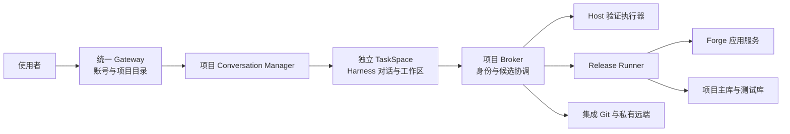

# 架构与源码导览

本页描述公开源码快照中的设计与实现入口，不代表线上环境的实时状态。首次使用见[上手指南](getting-started.md)，版本边界见[公开版本说明](release-status.md)。

## 两个仓库怎样配合

**ForgeAdminHarness 是开发交付平台，ForgeAdminFoundation 是应用底座。** 本仓库组织人、模型、项目、代码工作区、验证和发布；[ForgeAdminFoundation](https://github.com/zhiyuxinxi/ForgeAdminFoundation) 提供业务系统后端、PC 管理端、移动端与公共组件。

底座可按自身指南独立部署。隔离台需要应用源码、运行合同、数据库与模型服务才能完成实际交付。任意项目放入目录不等于接入完成；当前初始化脚本也不会自动取用公开 Foundation 的最新代码，具体限制见上手指南。

## 从对话到交付

这是职责关系图。验证、准备、晋升和发布需各自条件成立；模型回复“完成”不代替执行结果。

## 组件与源码

| 组件 | 职责 | 源码入口 |
| --- | --- | --- |
| Gateway | 登录、项目成员关系、对话入口与请求归属校验 | [conversation-gateway.mjs](../docker/harness/conversation-gateway.mjs) |
| Conversation Manager | 在指定项目内创建和管理对话工作舱 | [conversation-manager.mjs](../docker/harness/conversation-manager.mjs)、[taskspacectl.sh](../scripts/taskspacectl.sh) |
| TaskSpace / Harness | 每个对话独立的源码、分支、状态、上传和缓存 | [工作舱模板](../templates/taskspace/compose.yaml)、[Harness 镜像](../docker/harness/Dockerfile) |
| Broker | 核对受控请求、候选、身份、授权和集成条件 | [taskspace-broker.mjs](../docker/harness/taskspace-broker.mjs) |
| Host 验证执行器 | 执行限定验证任务、复用兼容依赖并返回结果 | [host-verification-runner.mjs](../docker/harness/host-verification-runner.mjs) |
| 受保护验收服务 | 管理验收请求与结果，供后续动作核对 | [forge-protected-acceptance-service.mjs](../docker/harness/forge-protected-acceptance-service.mjs) |
| Release Runner | 候选准备、构建、迁移、启动检查和发布 | [release-runner.mjs](../docker/harness/release-runner.mjs) |
| 文件入口 | 对话上传及项目目录资料输入 | [文件网关模板](../templates/file-gateway/compose.yaml)、[file-gatewayctl.sh](../scripts/file-gatewayctl.sh) |
| 文档门户 | 搜索、阅读交付工作卡 | [playbook-portal](../playbook-portal/)、[作业手册](ai-delivery-playbook/README.md) |

## 三层隔离

平台层管理统一账号、项目目录和公共入口。项目层拥有独立目录、Compose 身份、网络、卷、应用端口、Git 集成线与私有远端，配置主库、测试库和 Redis 逻辑库。对话层拥有独立 clone、任务分支、Harness 状态、上传、缓存和分配端口。

同项目的对话可并行开发，但共享应用版本和数据库，不各自拥有独立生产环境。发布需要协调到同一集成线；后发候选需处理已集成变更。独立工作区减少文件覆盖，但不能消除语义冲突与数据库冲突。

Redis 逻辑库是应用层分配方式，不是物理实例隔离。更强隔离需要按实际环境配置独立实例、账号和网络。

## 资料与权限

工作舱写自己的工作区，按授权读取集成基线和项目资料。网页上传属于当前对话，文件网关资料属于获准项目。附件不能自动变成高权限指令。

模型密钥、数据库凭据、Git Deploy Key 和控制令牌由服务器侧管理。Harness 不挂载宿主 Docker socket；Manager、Runner 等特权控制组件仍需独立保护，见[安全说明](security.md)。

## 应用形态与源码阅读顺序

[create-project.sh](../scripts/create-project.sh) 支持 `pc-only`（Admin、Flow、UI）及 `pc-mobile`（增加 App）。缺少移动源码或 Dockerfile 时，不能靠选择模式得到移动能力。统一入口可用，也不等于动态工作舱端口和应用服务均可达。

1. 阅读 [versions.env](../config/versions.env) 与 [platform.env.example](../config/platform.env.example)。
2. 阅读 [create-project.sh](../scripts/create-project.sh) 与 [projectctl.sh](../scripts/projectctl.sh)。
3. 按组件查看 [templates](../templates/) 中的真实网络、挂载和服务依赖。
4. 需要理解模型执行规范时，再读 [Harness Skills](../docker/harness/skills/)。

源码、制品、实际运行版本和业务验收是不同证据层。更新一个组件，不代表旧工作舱和其他服务自动同步。
